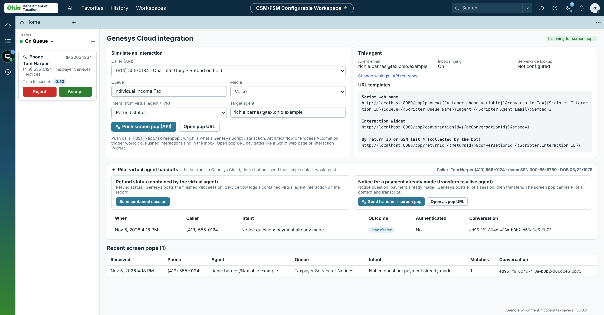
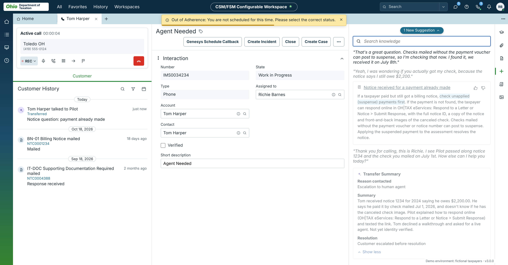
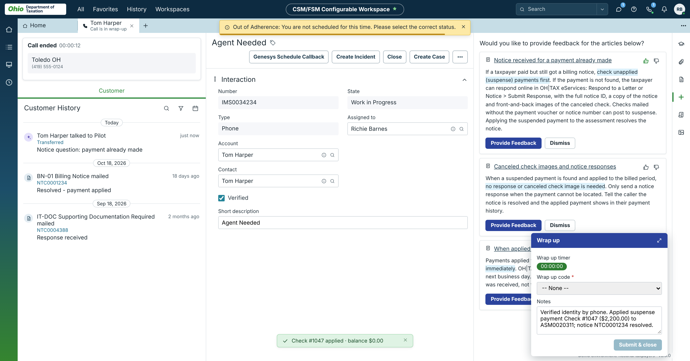
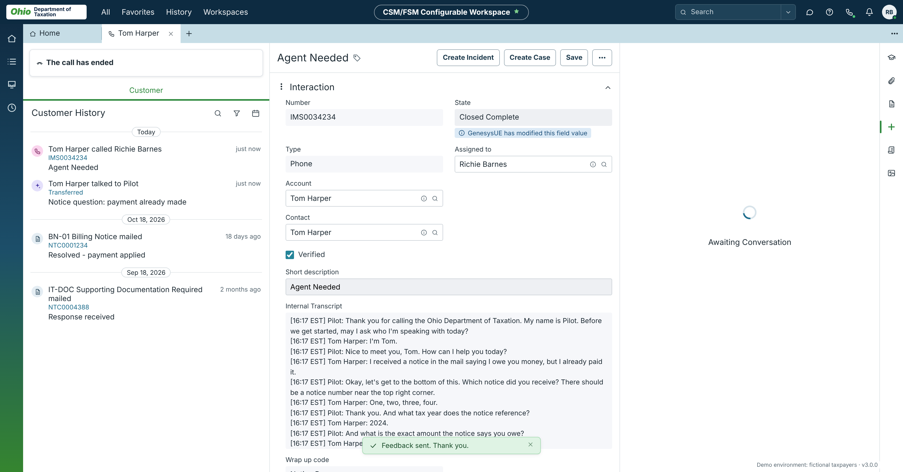
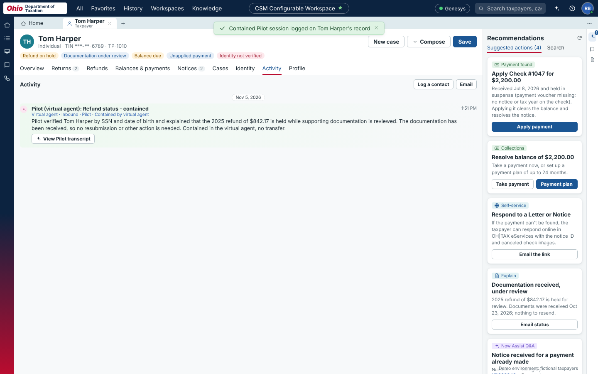
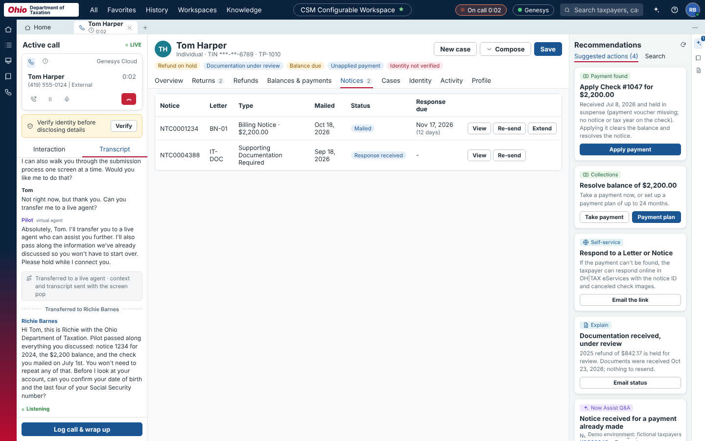
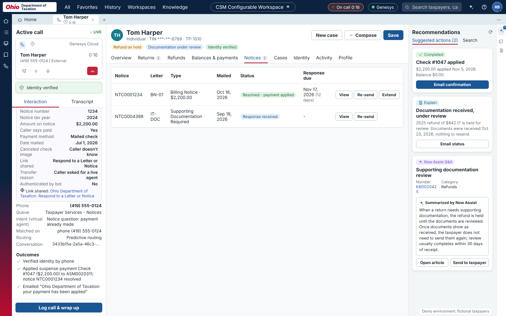

# SNOW Mock UI: User Guide

This guide is for **version 3.0.0**. It covers hosting the mock ServiceNow taxpayer workspace, running a demo, popping it from Genesys Cloud, and making it your own: new taxpayers, your own cell phone, agents, branding and data.

All data in the app is fictional. The app is not affiliated with ServiceNow, Genesys or any state agency.

**Contents**

1. [What it is](#1-what-it-is)
2. [Hosting on Render](#2-hosting-on-render)
3. [Running locally](#3-running-locally)
4. [A tour of the workspace](#4-a-tour-of-the-workspace)
5. [Running a demo](#5-running-a-demo)
6. [Screen pops](#6-screen-pops)
7. [Genesys Cloud setup](#7-genesys-cloud-setup)
8. [Customizing](#8-customizing)
9. [Data, resets and persistence](#9-data-resets-and-persistence)
10. [Troubleshooting](#10-troubleshooting)
11. [Reference](#11-reference)

---

## 1. What it is

A small Node.js web server plus a single-page app that looks like a ServiceNow CSM/FSM Configurable Workspace set up for a state department of taxation. Agents sign in as a persona and take screen-popped calls from Genesys Cloud. An accepted call opens an **interaction record**, with the call card, Customer History, Agent Assist and a Wrap up dock. From there the agent works the caller's record: verify identity, release refunds, take payments, set up payment plans, re-send notices, create cases and wrap up.

Key points:

- **No dependencies, no build.** Node 18 or newer runs `server.js` directly.
- **Data lives on the server, in memory.** The browser, a Genesys data action and a screen pop all see the same records. Data is reseeded from code on every restart, once a day, and on demand (see [section 9](#9-data-resets-and-persistence)).
- **Branding is configuration.** The default is the Ohio Department of Taxation. Other agencies are entries in `lib/brands.js`.

Where things are in the repo:

| Path | What it holds |
|---|---|
| `server.js` | The web server, API, screen-pop push, and env var handling |
| `lib/seed.js` | All demo data: agents, taxpayers, returns, notices, cases, knowledge articles |
| `lib/brands.js` | Agency branding: names, forms, area codes, cities, logo, colors |
| `lib/scenarios.js` | Scripted Pilot virtual agent sessions (intents, collected details, transcripts) |
| `lib/assist.js` | Agent Assist scripts for the interaction screen: the live call lines and the knowledge article suggested for each |
| `CHANGELOG.md` | Release notes for each version |
| `public/` | The workspace app (`index.html`, `js/app.js`, `js/ai.js`, `css/app.css`) |
| `public/api-docs.html` | API reference, served at `/api-docs.html` |
| `genesys/` | Genesys Cloud data action definitions to import |
| `public/retail/` | The original Haven & Hill retail guided demo, served at `/retail/` |
| `render.yaml`, `Dockerfile` | Hosting config |

---

## 2. Hosting on Render

### First deploy

1. Sign in at <https://render.com> with your GitHub account.
2. Choose **New > Blueprint** and pick the `jchadcole/snow-mock-ui` repository.
3. Render reads `render.yaml` and creates a free web service named `snow-mock-ui`. Click **Apply**.
4. When the deploy finishes, open the URL Render shows, normally `https://snow-mock-ui.onrender.com`.
5. Check `https://YOUR-HOST/api/health`. It returns `"status": "ok"`, the active brand and the date the data was seeded.

`render.yaml` sets three environment variables for you: `BRAND=ohiotax`, a randomly generated `API_KEY`, and `FRAME_ANCESTORS=*`. You can see and change them under the service's **Environment** tab.

### Updating

Render redeploys automatically whenever `main` changes. Changing an environment variable in the Render dashboard also restarts the service.

### Environment variables

| Variable | Default | What it does |
|---|---|---|
| `BRAND` | `ohiotax` | Agency branding used when the server starts. Must be an id from `lib/brands.js`. |
| `API_KEY` | (none) | When set, `/api/screenpop` and `/api/taxpayers/lookup` require it as `x-api-key`, `Authorization: Bearer`, or `?apiKey=`. The workspace's own pages don't need it. |
| `DEMO_PHONES` | (none) | Adds real phone numbers to demo taxpayers. See [8.1](#81-map-your-cell-phone-to-a-taxpayer). |
| `RESET_DAILY` | on | Set to `false` to stop the automatic daily reseed. |
| `PUBLIC_URL` | from request | Base URL used in `popUrl` values returned by the API, e.g. `https://snow-mock-ui.onrender.com`. Only needed behind an unusual proxy. |
| `FRAME_ANCESTORS` | `*` | Which sites may show the app in an iframe. `*` allows all Genesys Cloud regions. To restrict, list origins separated by spaces, e.g. `https://apps.mypurecloud.com https://apps.usw2.pure.cloud`. |
| `GENESYS_REGION` | `mypurecloud.com` | Optional. Genesys Cloud region domain for the server-side conversation lookup. |
| `GENESYS_CLIENT_ID`, `GENESYS_CLIENT_SECRET` | (none) | Optional. A Client Credentials OAuth client that can read conversations. Lets a pop find the caller from only a `conversationId`. |

### Free plan behavior

Free Render services go to sleep after about 15 minutes with no traffic and take 30 to 60 seconds to wake. Because data is in memory, **waking up also reseeds the data**. Before a recording, open the site a minute early and then use **Settings > Reset demo data** so you start from a clean state. A paid instance does not sleep.

### Other hosts

The included `Dockerfile` runs anywhere that runs containers. Expose port 8080 or set `PORT`.

---

## 3. Running locally

```bash
git clone https://github.com/jchadcole/snow-mock-ui.git
cd snow-mock-ui
node server.js                 # http://localhost:8080
PORT=3000 node server.js       # another port
npm run dev                    # restarts on code changes (node --watch)
```

Environment variables work the same way locally:

```bash
BRAND=pinecrest DEMO_PHONES="3175551234=tp-1001" node server.js
```

Genesys Cloud cannot reach `localhost`, so for an end-to-end Genesys test use the Render URL (or a tunnel such as ngrok).

---

## 4. A tour of the workspace

### Signing in

The sign-in page lists the demo agents. Click one; there is no password. The choice is remembered in that browser.

| Persona | Name | Role | Email (Ohio brand) |
|---|---|---|---|
| `agent` | Richie Barnes | Taxpayer Services Agent | `richie.barnes@tax.ohio.example` |
| `business` | Dana Whitfield | Business Tax Specialist | `dana.whitfield@tax.ohio.example` |
| `supervisor` | Morgan Lee | Contact Center Supervisor | `morgan.lee@tax.ohio.example` |

If a screen pop URL arrives and nobody is signed in, the app signs in the `agent` persona automatically (or the one named with `?persona=`).

### Layout

- **Top bar**: All, Favorites, History, Workspaces, the workspace name, Search (with a scope menu ▾), chat, help, the **phone** icon (opens the Genesys page; shows a badge and a dot when connected), the **bell** (recent pops), and your avatar (opens **Settings**).
- **Left rail**: Home, Lists, Inbox, and History (the interactions list).
- **Inbox**: your status (On Queue by default, with a gear) and ringing calls. Each card shows Phone, the IMS number and **Time to accept 0:55**, with **Reject** and **Accept**.
- **Home**: open cases, today's schedule and adherence, queue stats, recent interactions, plus Insights, Scorecard and Schedule tabs.
- **Interaction record** (what an accepted call opens): see [5.1](#51-the-interaction-screen).
- **Taxpayer record**: tabs for Overview, Returns, Refunds, Balances & payments, Notices, Cases, Identity, Activity and Profile, with **Recommendations** (next best actions and a matching knowledge article) and **Now Assist** (a rule-based assistant that answers from the record and the knowledge base; it doesn't call a real AI service).
- **Version**: the running version shows on the sign-in page, in the footer, and in Settings.

#### Two screens for a call

By default, an accepted **voice** call opens the **interaction record** (version 3). The earlier layout (version 2) opens the **taxpayer record** instead, with an interaction column on the right: caller card, identity badge, Genesys details, outcomes, live transcript, and **Log call & wrap up**. Chats and messages always use the taxpayer record.

To use the taxpayer record for calls, choose **Settings > Screen pops open > The taxpayer record**, or add `view=taxpayer` to a pop URL.

### Settings (click your avatar)

| Setting | What it does |
|---|---|
| Genesys Cloud agent email | Push screen pops addressed to this email open in this browser. Defaults to the persona's email. Set it to your real Genesys agent email when pops come from Genesys. |
| Ring pushed calls in the inbox | On: a push pop rings in the inbox with Accept / Reject and a countdown (55 seconds by default). Off: it opens straight away. |
| Open the record automatically | With ringing off, opens the record as soon as the pop arrives. Otherwise shows a toast with Open / Dismiss. |
| Screen pops open | **The interaction record** (default) or **The taxpayer record** (the version 2 layout). |
| Color scheme | Brand default, the workspace template colors, or the brand's own colors. The default for each brand is its `ui.palette` setting. |
| Brand | Switch agency. Switching reseeds all data with that agency's names, forms and area codes. |
| Version and Release notes | The running version and build, and the release notes from `CHANGELOG.md`. |
| Reset demo data | Restores every record to its starting state and closes open tabs. |
| Switch user | Back to the sign-in page. |

Settings are stored in the browser (localStorage), so each browser keeps its own.

---

## 5. Running a demo

### Before you record

1. Open the site a minute ahead so a sleeping Render instance wakes up.
2. Sign in as **Richie Barnes** (or open a pop URL, which signs him in).
3. **Settings > Reset demo data**.
4. If Genesys will push the pop, check that the agent email in Settings matches the Genesys agent who will answer, and that the Genesys page shows **Listening for screen pops**.
5. Use a browser window sized for the recording, and close tabs you don't want on screen.
6. Practice with `]`: it brings in the next Agent Assist line immediately, so you can pace the demo to your narration.

### 5.1 The interaction screen

When a call is accepted, the workspace opens an interaction record (an IMS number), laid out like a CSM/FSM Configurable Workspace:

- **Left**: the call card and Customer History.
- **Middle**: the Interaction form (Account, Contact, Verified, State, short description).
- **Right**: Agent Assist and the utility rail (Learning, Attachments, Record details, Agent Assist, Script, Images).
- **Header**: Genesys Schedule Callback, Create Incident, Close, Create Case, and the more menu (⋯).



**What happens on a call:**

1. **Accept.** The inbox closes. A new tab shows "Loading…", then "Record", then the caller's name.
2. **The record loads.** The title is **Agent Needed** for a Pilot transfer, otherwise the intent. State is Work in Progress, and Agent Assist shows **Related Search Results**.
3. **The call connects.** The yellow **Out of Adherence** toast slides in (close it with ✕). The call card shows **Active call** with a timer, the caller's city and number, and the controls. Customer History reloads.
4. **Agent Assist loads.** The **Search knowledge** box appears. For a Pilot transfer, it shows the bot's **Transfer Summary** (Reason contacted, Summary, Resolution). Hover the summary to see the AI accuracy note.
5. **Suggestions arrive.** Every 7 seconds a **New Suggestion** pill brings the next caller or agent line with its knowledge card. The key sentence is highlighted, and older cards fade. Press **]** to bring in the next line right away.
6. **Hang up** (red button) or **Close.** The tab reads **Call is in wrap-up**, Agent Assist asks for feedback on each article (Provide Feedback / Dismiss), and the **Wrap up** dock opens.
7. **Submit & close.** Pick a **Wrap up code** to enable the button. Notes are prefilled from what you did on the call. The card shows "The call has ended", State becomes **Closed Complete**, the **Internal Transcript** fills in, and Customer History gets a new entry at the top.







**Every click on the screen:**

| Where | Click | Result |
|---|---|---|
| Call card | REC ▾ | Pause or resume recording (red dot) |
| Call card | Mute | Gray slashed microphone, "Unmute yourself" tooltip |
| Call card | Hold | The card shows "On hold" |
| Call card | Keypad | A dial pad that records the digits |
| Call card | Transfer → | Pick a queue or agent. A blind transfer ends the call and opens wrap up. |
| Call card | Flag | Flags the interaction for a supervisor |
| Customer History | Search, filter, calendar | Search the list, filter by calls, cases, virtual agent or notices, or show the last 30 days |
| Customer History | An entry | Opens that interaction, case, Pilot transcript or notice |
| Form | ⓘ on Account or Contact | Taxpayer preview with **Open record** |
| Form | Verified | Opens identity verification when the caller isn't verified yet |
| Form | Collapse chevron | Collapses the Interaction section |
| Header | Genesys Schedule Callback | Number, date and time, and queue. Logs the callback. |
| Header | Create Incident / Create Case | Creates an INC or CS record. The case is linked to the interaction. |
| Header | ⋯ | Open taxpayer record, Verify identity, Apply suspense payment, Refund details, Email the taxpayer, View the Pilot transcript, Copy the IMS number |
| Header (after closing) | Save | Saves the short description |
| Agent Assist | 👍 / 👎 | Relevant / Irrelevant (click again to clear) |
| Agent Assist | Article title | Opens the article with **Send to taxpayer** |
| Agent Assist | Search knowledge | Searches the articles. **Clear** goes back to suggestions. |
| Right rail | Learning, Attachments, Record details, Agent Assist, Script, Images | Switches the right panel. Script shows Pilot's handoff and transcript. |
| Wrap up | ⤢ | Enlarges the dock |

The text on this screen (title, countdown, toast, presence states, wrap up codes, Agent Assist speed, Transfer Summary wording) is configurable. See [8.5](#85-change-the-interaction-screen-text) and [8.6](#86-change-the-agent-assist-scripts).

### The main story: Charlotte Gong, (614) 555-0184

Charlotte's $1,284 refund is on hold for identity verification, and the Identity Confirmation Quiz letter went to her old address and came back undeliverable. She spoke to Richie by chat four days ago.

**On the interaction screen** (the default): pop her number (`/pop?phone=6145550184`, or push it from the Genesys page) and **Accept**. Agent Assist suggests the refund timeline and identity articles as she talks. Use **⋯ > Verify identity**, then **⋯ > Refund details** to open her Refunds tab, where you release the refund and switch it to direct deposit. Use **⋯ > Email the taxpayer**, then hang up, pick a wrap up code, and **Submit & close**.

**On the taxpayer screen** (`view=taxpayer`, or Settings > Screen pops open), her story has a scripted live transcript that waits for each action:

1. **The call pops.** From Genesys, or from the Genesys page in the app (pick Charlotte, intent "Refund status", then **Push screen pop** or **Open pop URL**). Her record opens with the call card and the **Transcript** tab.
2. **Verify identity.** Open **Verify identity** (from the identity badge, the Identity tab or the recommendations). The dialog lists four knowledge-based questions with the expected answers shown for the presenter: date of birth (April 12, 1989), SSN last 4 (4471), prior-year AGI, and the address on the return. Mark each **Matched** (or use **Mark all matched**) and click **Verify**. Marking any answer **No match** fails the check.
3. **Release the refund.** The release is blocked until identity is verified. The refund gets a release ID and an expected date.
4. **Switch to direct deposit.** Enter any 9-digit routing number and an account number. The expected date moves up.
5. **Email a confirmation.** Compose email drafts a message to `c.gong@gmail.com`; send it.
6. **Wrap up.** **Log call & wrap up** shows an AI-style summary. Pick a wrap-up code, keep case CS0001042 linked with **Resolve the linked case** ticked, and click **Save and end interaction**. The interaction appears in Activity.

On this screen the transcript is scripted. Each agent line waits for the matching action (verify, release, direct deposit, email), so the conversation keeps pace with what you do on screen.

### Other callers

| Number | Taxpayer | What to show |
|---|---|---|
| (614) 555-0142 | Marcus Johnson | Billing notice balance of $2,341.18. Take a payment or set up a payment plan (intent "Make a payment" or "Payment plan" opens Balances). |
| (216) 555-0131 | Raj and Priya Patel | Shared home phone. Two matches, so the agent picks the taxpayer. |
| (937) 555-0163 | Linda Okafor | W-2 Request for Information due soon. Extend the due date or re-send the notice. |
| (614) 555-0199 | Riverbend Brewing Co. LLC | Business caller. Delinquent sales tax return and an estimated assessment (sign in as Dana Whitfield). |
| (513) 555-0155 | Elena Ruiz, CPA, for Thomas Reed | Authorized representative with a power of attorney, asking about an amended return. |
| (216) 555-0161 | Anika Choudhury | Estimated payment still posting. |
| (330) 555-0177 | Maria Delgado | Spanish speaker; refund partly offset to child support. |
| (419) 555-0124 | Tom Harper | The two Pilot virtual agent scenarios. See [5.2](#52-pilot-virtual-agent-scenarios-tom-harper). |
| any other | none | No match, so the agent creates a new contact. |

On the interaction screen, every caller gets Agent Assist lines from `lib/assist.js`: Charlotte, Marcus, Linda and Tom's transfer have their own, and other callers get a short default. On the taxpayer screen, only Charlotte and Tom have scripted transcripts.

### 5.2 Pilot virtual agent scenarios (Tom Harper)

The virtual agent, "Pilot", runs in Genesys Cloud. This app shows only the ServiceNow side: what Pilot logged, and what the agent sees after a transfer.

**Tom Harper**: (419) 555-0124, taxpayer ID `tp-1010`. Demo SSN 900-55-6789, date of birth 03/22/1978, which Pilot uses for its SSN and date-of-birth lookup.

- His 2025 return was received April 14. The $842.17 refund, going by direct deposit, is on hold for "Supporting documentation review". The documents have arrived and are waiting for review; the Refunds tab shows this.
- Billing Notice BN-01 (`NTC0001234`) says he owes $2,200.00 for 2024.
- His check #1047 for $2,200 was mailed July 1 and received July 8. It sits in **Unapplied payments (suspense)** because it came without a voucher or notice number.

#### Use case 1: Refund status, contained by Pilot

Pilot authenticates Tom with his SSN and date of birth and tells him the refund status. No agent is involved and there is no screen pop.

1. Genesys posts the finished session to `POST /api/bot-sessions` with outcome `Contained`.
2. Tom's **Activity** tab shows "Pilot (virtual agent): Refund status - contained", with Pilot's summary.
3. **View Pilot transcript** opens the full conversation: intent and confidence, the keypad SSN and date-of-birth entries, "Identity verified", and the refund lookup.
4. The session also appears under **Pilot virtual agent handoffs** on the Genesys page.



#### Use case 2: Notice for a payment already made, transferred to an agent

Tom calls about notice 1234 and says he already paid by check. Pilot collects the details, shares the Respond to a Letter or Notice link, and transfers him to an agent.

Genesys posts the session with outcome `Transferred`, then screen pops with the **same** `conversationId`. The pop rings in the inbox as usual.

**On the interaction screen** (the default), after **Accept**:

1. The record is titled **Agent Needed**, and Agent Assist opens with Pilot's **Transfer Summary**. The **Script** button on the right rail shows Pilot's handoff details and transcript.
2. Agent Assist suggests KB0020426, KB0020427 and KB0020428 as Tom asks about his check.
3. Use **⋯ > Verify identity** (Pilot didn't authenticate Tom on this call), then **⋯ > Apply suspense payment**. The balance drops to $0 and the notice becomes "Resolved - payment applied".
4. Hang up, pick a wrap up code (for example Notice Response), and **Submit & close**.

**On the taxpayer screen** (`view=taxpayer`):

1. The **Transcript** tab shows Pilot's conversation first, then a "Transferred to (agent)" divider, then the live call, which advances as the agent acts.
2. The **Interaction** tab shows the **Pilot handoff card**: intent and confidence; the details Pilot collected (notice 1234, tax year 2024, $2,200, paid by check mailed July 1, canceled check image unknown); the link Pilot shared; and the transfer reason.





Then, on this screen, the agent:

1. **Verifies identity.** Pilot didn't authenticate Tom on this call.
2. **Applies the payment**, from the **Payment found** recommendation or from **Balances & payments > Unapplied payments**. The balance drops to $0 and the notice becomes "Resolved - payment applied".
3. **Emails a confirmation**, which Now Assist drafts.
4. **Logs the call and wraps up.** The AI summary includes Pilot's context.

#### Running the Pilot scenarios without Genesys

- **Genesys page > Pilot virtual agent handoffs**: **Send contained session** logs use case 1. **Send transfer + screen pop** sends use case 2 to the agent email in Settings, where it rings in the inbox.
- **URL**: `/pop?scenario=notice-paid` logs the transfer session and opens the pop directly. `/pop?scenario=refund-status` logs the contained session.
- **Reset**: **Settings > Reset demo data** puts Tom's check back in suspense, restores his balance, and clears all Pilot sessions.

### Retail demo

The original Haven & Hill retail guided demo (Charlotte Gong and the ottoman) is at `/retail/`. Press the backtick key (`` ` ``) there to open its presenter panel. It is a separate, browser-only demo and doesn't use the server data or the settings above.

---

## 6. Screen pops

There are two ways to pop a record. Both create the call card and start an interaction.

### 6.1 By URL

Open `https://YOUR-HOST/pop?...` in the agent's browser, a Genesys Script web page, or an Interaction Widget.

```
https://YOUR-HOST/pop?phone=6145550184&conversationId=abc-123&queue=Individual%20Income%20Tax&intent=Refund%20status
```

| Parameter | Meaning |
|---|---|
| `phone` (or `ani`, `callerId`) | Caller's number in any format: `6145550184`, `(614) 555-0184`, `tel:+16145550184`. The last 10 digits are matched against every phone on every taxpayer. |
| `taxpayerId` | Open this taxpayer directly, e.g. `tp-1001`. Takes priority over `phone`. |
| `returnId` | Find the taxpayer by a return ID, e.g. one the bot collected. |
| `last4`, `lastName` | SSN/FEIN last 4 and last name. With `phone`, `last4` narrows a shared phone to one person. |
| `conversationId` (or `gcConversationId`, `interactionId`) | Genesys conversation ID. Shown on the call card and saved with the wrap-up. If no phone is given and the server has Genesys credentials, the caller's number is looked up from Genesys. |
| `queue`, `intent`, `direction`, `mediaType` | Shown on the call card. `mediaType` is `voice`, `chat` or `message`. |
| `customerName` | Shown when there is no match. |
| `scenario` | Run a scripted Pilot session first, then pop: `notice-paid` (transfer) or `refund-status` (contained). See [5.2](#52-pilot-virtual-agent-scenarios-tom-harper). |
| `tab` | Open on a specific tab: `overview`, `returns`, `refunds`, `balances`, `notices`, `cases`, `identity`, `activity`, `profile`. |
| `view` | `taxpayer` opens the version 2 taxpayer screen for this pop instead of the interaction record. Overrides Settings for that pop. |
| `embed=1` | Compact layout for an iframe. Turned on automatically when the app is framed; `embed=0` turns it off. |
| `agent` | Sets this browser's agent email for push pops (same as Settings). |
| `persona` | `agent`, `business` or `supervisor`: who to sign in if nobody is. |
| `brand` | Switches agency **and reseeds all data**. Leave it out of pop URLs used during a demo, or the demo resets on every call. |

If you don't pass `tab`, the intent decides: "pay", "plan", "balance" or "bill" opens **Balances**; "notice" or "letter" opens **Notices**; anything else opens **Overview**.

Results: one match opens the record, several matches show a picker, and no match offers **New contact** with the phone filled in. Unfilled Genesys placeholders such as `{{Call.Ani}}` are ignored, so a template that isn't fully wired up won't break the pop.

### 6.2 By push (API)

`POST /api/screenpop` looks up the caller and sends the pop to every open workspace whose agent email matches, over Server-Sent Events. Depending on Settings, it rings in the inbox or opens directly.

```bash
curl -X POST https://YOUR-HOST/api/screenpop \
  -H "Content-Type: application/json" -H "x-api-key: $API_KEY" \
  -d '{"phone":"tel:+16145550184","agent":"richie.barnes@tax.ohio.example","conversationId":"abc-123","queue":"Individual Income Tax","intent":"Refund status","mediaType":"voice"}'
```

| Field | Meaning |
|---|---|
| `phone` | Caller's number (or use `taxpayerId`, `returnId`, `last4`, `accountNumber`) |
| `agent` | The agent email set in Settings of the browser that should pop. The persona's user id (`u-1`) also works. `*` pops every open browser. |
| `conversationId`, `queue`, `intent`, `mediaType`, `direction`, `customerName`, `tab` | Same as the URL parameters |

The response contains the lookup result plus `screenPopId` and `deliveredTo`, the number of browsers that received it. `deliveredTo: 0` means no open browser is listening for that agent email.

A green dot and **Listening for screen pops** on the Genesys page mean the browser is connected.

### 6.3 Testing without Genesys

The **Genesys** page (phone icon on the left rail) has a simulator. Pick a caller, queue, media type, intent and target agent, then:

- **Push screen pop (API)** calls `POST /api/screenpop`, as a Genesys data action would.
- **Open pop URL** navigates to `/pop?...`, as a Script web page would.

It also shows the URL templates for your host, the last 50 pops received, and a **Pilot virtual agent handoffs** section that runs Tom Harper's two scenarios and lists recent Pilot sessions.

---

## 7. Genesys Cloud setup

Pick the pattern that suits the demo. You can combine them.

| Pattern | What the audience sees | What to configure |
|---|---|---|
| Script web page | The record inside the Genesys agent desktop | A Script with a Web Page component |
| Interaction Widget | The record in a tab of the Genesys interaction | An Interaction Widget integration |
| Push to a separate browser | ServiceNow on its own screen pops when the agent answers | The Push Screen Pop data action, called from a Script or flow |
| Bot / IVR lookup | The virtual agent knows the refund status before transferring | The Lookup data action in Architect |
| Pilot session log | The record shows what the virtual agent did, and the agent gets a handoff card | The Log Bot Session data action at the end of the bot flow |

### 7.1 Import the data actions

1. In Genesys Cloud Admin, go to **Integrations** and add a **Web Services Data Actions** integration. Name it, for example, "SNOW Tax Mock".
2. On its **Credentials** tab, choose **User Defined** and add one field named `apiKey`, with the value of `API_KEY` from Render (service > **Environment**). Activate the integration.
3. Go to **Integrations > Actions > Import**, choose a file from the repo's `genesys/` folder, and pick your new integration. Import each file:

   | File | Use | Inputs | Outputs |
   |---|---|---|---|
   | `lookup-taxpayer-by-phone.json` | Bot or IVR lookup before routing | `phone` | `found`, `count`, `taxpayerId`, `fullName`, `firstName`, `language`, `identityStatus`, `refundStatus`, `refundAmount`, `refundHold`, `balanceDue`, `openCaseNumber`, `representative`, `popUrl` |
   | `push-screen-pop.json` | Pop the agent's browser | `phone`, `agentEmail`, plus optional `conversationId`, `queue`, `mediaType`, `intent`, `taxpayerId` | `found`, `count`, `taxpayerId`, `fullName`, `popUrl`, `deliveredTo` |
   | `log-interaction.json` | Write a call record to the taxpayer's Activity | `taxpayerId`, plus `direction`, `subject`, `note`, `wrapCode`, `conversationId`, `queue`, `durationSec` | `activityId` |
   | `log-bot-session.json` | Save a Pilot session (contained or transferred) | `conversationId`, `outcome`, plus `phone` or `taxpayerId`, `intent`, `taxType`, `confidence`, `queue`, `authenticated`, `authMethod`, `summary`, `transcript`, `noticeNumber`, `noticeTaxYear`, `noticeAmount`, `paymentMethod`, `paymentDate`, `transferReason` | `botSessionId`, `taxpayerId` |

4. Each file points at `https://snow-mock-ui.onrender.com`. If your host is different, edit the **Request URL Template** on the action's **Setup** tab.
5. Use **Test** on each action (for example, phone `+16145550184`), then **Publish**.

### 7.2 Bot or IVR lookup (Architect)

In the inbound call or bot flow, call **Lookup Taxpayer by Phone** with `Call.Ani`. To look up by SSN and date of birth instead, as Pilot does, call `GET /api/taxpayers/lookup?ssn=900556789&dob=1978-03-22` (for example by copying the lookup action and changing its URL). The lookup also returns `refundMethod`, `returnReceived`, `returnStatus`, `documentationStatus`, `openNoticeId` and `unappliedPayments`. Save the outputs to flow variables and use them:

- Say "I see your refund of {refundAmount} is on hold for identity verification" when `refundStatus` is "On hold".
- Set participant data (for example `taxpayerId`, `intent`, `refundStatus`) before **Transfer to ACD**, so the Script and the agent can use it.
- Route on `language` (Maria Delgado is Spanish) or on `found`.

### 7.3 Script web page

In a Genesys Script, add a **Web Page** component with this source (variables in `{{ }}` are Script variables):

```
https://YOUR-HOST/pop?phone={{Call.Ani}}&conversationId={{Scripter.Interaction ID}}&queue={{Scripter.Queue Name}}&agent={{Scripter.Agent Email}}&intent={{Intent}}&embed=1
```

`Intent` is a Script variable you create and fill from participant data set by the flow. Drop any parameter you don't use. To show a taxpayer the bot already identified, use `taxpayerId={{taxpayerId}}` instead of `phone`.

Assign the Script to the queue (or set it in the flow), and the record pops inside the agent desktop when the agent answers.

### 7.4 Interaction Widget

Add an **Interaction Widget** integration with this Application URL:

```
https://YOUR-HOST/pop?conversationId={{gcConversationId}}&embed=1
```

The widget only passes the conversation ID, so the server has to look up the caller's number from Genesys. Create an OAuth client in Genesys (**Admin > OAuth**, grant type **Client Credentials**, with a role that can view conversations), then set `GENESYS_CLIENT_ID`, `GENESYS_CLIENT_SECRET` and `GENESYS_REGION` (for example `usw2.pure.cloud`) in Render. `/api/health` shows `"genesysLookup": true` when it's configured.

### 7.5 Push to a separate browser

This is the "screen pop in ServiceNow" moment from the demo video: Genesys on one screen and the ServiceNow workspace on another.

1. Open the workspace in its own browser window and sign in as the agent.
2. In **Settings**, set the agent email to the Genesys user's email (or open the site once with `?agent=you@example.com`).
3. In the Genesys Script, add an action on **Script load** (which runs when the agent answers) that calls **Push Screen Pop** with `phone = {{Call.Ani}}`, `agentEmail = {{Scripter.Agent Email}}` and `conversationId = {{Scripter.Interaction ID}}`. You can also call it from the flow or from a Process Automation trigger.
4. When the agent answers, the workspace rings in the inbox (or opens directly if ringing is off in Settings).

### 7.6 Wrap-up back to the record

The workspace's own **Log call & wrap up** writes the activity for you. To log from Genesys instead, call **Log Interaction** at wrap-up with the `taxpayerId` from the lookup.

### 7.7 Pilot sessions and the handoff card

At the end of the bot flow, call **Log Bot Session** with:

- `conversationId`: `Flow.ConversationId`. For a transfer this must be the same conversation ID the screen pop uses, or the handoff card won't appear.
- `outcome`: `Contained` or `Transferred`.
- `phone` (`Call.Ani`) or `taxpayerId`, so the session is filed on the right record.
- `transcript`: one utterance per line, written as `Speaker: text`, for example `Pilot: How can I help you today?`. Lines whose speaker matches the bot's name are shown as the bot; others as the caller.
- The collected details (`noticeNumber`, `noticeTaxYear`, `noticeAmount`, `paymentMethod`, `paymentDate`, `transferReason`), which fill the handoff card.

For a transfer, call it **before** Transfer to ACD, so the session is saved by the time the agent's screen pops. Then pop as in 7.3 to 7.5.

---

## 8. Customizing

Customizations fall into two kinds:

- **Environment variables** in Render (like `DEMO_PHONES`): change them in the dashboard; the service restarts in about a minute.
- **Code changes** in `lib/seed.js`, `lib/brands.js` or `public/`: edit the file (on GitHub, use the pencil icon), commit to `main`, and Render redeploys in a few minutes. Locally, restart `node server.js` or use `npm run dev`.

Edits you make in the app (new contacts, payments, address changes) only last until the next reset. To make something permanent, put it in `lib/seed.js`.

### 8.1 Map your cell phone to a taxpayer

To call the Genesys number from your own phone and have Charlotte pop, set `DEMO_PHONES` in Render (service > **Environment**):

```
DEMO_PHONES=3175551234=tp-1001
```

Two formats are accepted, and you can mix them, separated by commas:

| Format | Example | Meaning |
|---|---|---|
| `yourNumber=taxpayerId` | `3175551234=tp-1001` | Add your number to this taxpayer. Recommended. |
| `seededNumber:yourNumber` | `4195550124:+13175551234` | Add your number to whichever taxpayer has this demo number (here Tom Harper). |

```
DEMO_PHONES=3175551234=tp-1001,3175559876=tp-1002,4195550124:+13175554321
```

- Numbers can be in any format; only the last 10 digits matter. Don't use commas, `=` or `:` inside a number.
- The `seededNumber:` form depends on the brand's area codes, so it stops matching after you switch to a brand with different area codes. On a shared demo number (the Patels' 0131) it picks only the first taxpayer. The `=taxpayerId` form has neither problem.
- Your number is added to the taxpayer as a primary "Mobile (demo)" phone, and the seeded number still works.
- Two people can share one number by mapping it to two taxpayers; the pop then shows the picker.
- It survives resets and restarts, because it is reapplied every time data is seeded.

Taxpayer IDs:

| ID | Taxpayer |
|---|---|
| `tp-1001` | Charlotte Gong (main story) |
| `tp-1002` | Marcus Johnson |
| `tp-1003` | Raj Patel |
| `tp-1004` | Priya Patel |
| `tp-1005` | Linda Okafor |
| `tp-2001` | Riverbend Brewing Co. LLC |
| `tp-1007` | Thomas Reed (his CPA, Elena Ruiz, calls from his "Representative" phone) |
| `tp-1008` | Anika Choudhury |
| `tp-1009` | Maria Delgado |
| `tp-1010` | Tom Harper (Pilot scenarios) |

To check it worked, open `https://YOUR-HOST/api/taxpayers/lookup?phone=3175551234&apiKey=YOUR_KEY`. It should return `"found": true` and the taxpayer's name.

### 8.2 Add or change agents

Agents are the `users` list near the top of `lib/seed.js`:

```js
const users = [
  { id: 'u-1', name: 'Richie Barnes', role: 'Taxpayer Services Agent', persona: 'agent', email: `richie.barnes@${brand.emailDomain}`, group: 'Individual Income Tax' },
  ...
];
```

| Field | Notes |
|---|---|
| `id` | Unique, e.g. `u-4`. Push pops can target it as `agent`. |
| `name`, `role`, `group` | Shown on the sign-in page, home page and wrap-ups. `group` should be one of the `groups` listed just below `users`. |
| `persona` | Used by `?persona=` on pop URLs. Keep it unique if you want to pop straight into that agent. |
| `email` | The persona's default agent email for push pops. Use a real address (for example your Genesys login) to avoid changing it in Settings every time: `email: 'chad@example.com'`. |

Cases are assigned by agent name (`assignedTo: 'Richie Barnes'` in the `cases` list), and Charlotte's earlier chat names Richie in her activity history and transcript. If you rename Richie, search `lib/seed.js` for "Richie Barnes" and update those too. Also, `public/js/ai.js` uses the signed-in agent's first name in the transcript automatically.

The other names on the Home page leaderboard and scorecard (Allen Robinson, Gabriela Duran, Daniel Navarro) are fixed text in `public/js/app.js`; search for "Allen Robinson" to change them.

### 8.3 Add or edit taxpayers

Taxpayers are created by the `taxpayer({...})` calls in `lib/seed.js`. The easiest way to add one is to copy an existing block that's close to what you want, then change it.

A minimal individual:

```js
taxpayer({
  id: 'tp-1010', firstName: 'Jordan', lastName: 'Miller', tin: '***-**-1234', dob: '1990-06-01', filingStatus: 'Single',
  phones: [{ type: 'Mobile', number: ph(0, '0110'), primary: true }],
  email: 'jordan.miller@example.com', address: addr('100 High St.', 0),
  flags: ['Refund on hold'],
  returns: [
    { id: `RTN${TY % 100}012345`, taxYear: TY, form: F.individual, taxType: T.individual, filed: date(-30), method: 'e-File', status: 'Processing',
      refund: { amount: 500.00, status: 'Processing', method: 'Direct deposit' }, balanceDue: 0,
      steps: steps([['Return received', 'Complete', -30], ['Return processed', 'In progress', null]]) },
  ],
});
```

Helpers you can use inside `seed.js`:

| Helper | Meaning |
|---|---|
| `ph(i, '0110')` | Phone number using the brand's i-th area code: `ph(0, '0110')` is (614) 555-0110 for Ohio. Or write a literal number, e.g. `'(317) 555-1234'`. |
| `addr('100 High St.', i)` | Address in the brand's i-th city, with state, ZIP and county filled in. |
| `date(-30)` | 30 days before the day the data is seeded (`date(5)` is 5 days from now). Dates are relative so notices and due dates always look current. |
| `day(-4, '13:20')` | Date and time, for activities and cases. |
| `TY` | The most recent tax year (last year). |
| `F.individual`, `T.individual`, etc. | The brand's form numbers and tax type names, so the record matches the branding. |
| `steps([[name, status, dayOffset], ...])` | Processing steps shown on a return. Status words drive the color: Complete/Verified/Scheduled show green, Undeliverable/Missed red, Pending/Hold/Progress/Requested amber. |

Fields on a taxpayer (anything you leave out gets a sensible default):

| Field | Notes |
|---|---|
| `id` | Unique. Use `tp-` plus a number not already used. This is what `DEMO_PHONES` and `?taxpayerId=` refer to. |
| `type` | `Individual` (default) or `Business`. Businesses also need `businessName` and usually `dba`, `contact`, `accounts`. |
| `firstName`, `lastName`, `tin`, `dob`, `filingStatus`, `spouse` | Identity details. `tin` is shown masked as written; its last 4 digits are used by `?last4=` and the identity check. |
| `phones` | List of `{ type, number, primary }`. Any of them matches a screen pop. |
| `email`, `address`, `previousAddress`, `schoolDistrict`, `language`, `preferredContact`, `portalEnrolled` | Profile. `language: 'Spanish'` triggers the interpreter recommendation. |
| `flags` | Badges on the record, e.g. `'Refund on hold'`, `'Balance due'`, `'Response due'`, `'POA on file'`. Several drive recommendations. |
| `identity` | `{ status: 'Verified' }` by default. Use `{ status: 'Hold', reason: '...' }` to require verification before a refund can be released. |
| `returns` | Returns, each with an optional `refund` (`amount`, `status`, `method`, `hold`), an optional `documentation` (`requested`, `received`, `status`) and `steps`. A refund with `status: 'On hold'` gets the **Release** action. |
| `assessments` | Balances owed: `assessed`, `penalty`, `interest`, `paid`, `balance`, `due`. A positive `balance` enables payments and payment plans. |
| `payments`, `paymentPlan` | Payment history and an existing plan. |
| `notices` | Letters: `letter`, `type`, `date`, `status`, `due`, and optionally `amount` and `returnId`. |
| `bank` | `{ type, last4, bank }` for direct deposit. |
| `unapplied` | Payments held in suspense: `{ id, amount, method, mailed, received, status: 'Unapplied (suspense)', reason }`. They show under Balances & payments with an **Apply** action and a **Payment found** recommendation. |
| `demoSsn` | Full 9-digit demo SSN, used only by the `?ssn=&dob=` lookup and never shown or returned. Use a 900-series number so it can't be real. |
| `representative` | `{ name, firm, phone, form, expires, scope }` for a POA. Add the rep's number to `phones` with type `Representative` so their calls match. |
| `activities` | History shown on the Activity tab. |

To give a new taxpayer an open case, add an entry to the `cases` list further down (copy one and set `taxpayerId`, a unique `id` and `number`).

**Editing an existing taxpayer**: find their block by name and change the values, for example Charlotte's refund amount (`refund: { amount: 1284.00, ...}`) or her email. Charlotte's scripted transcript in `public/js/ai.js` reads her name, refund amount, tax year and form from the record, but some lines mention specifics (her date of birth, "4471", "Old Mill Road", "Neil Avenue", chatting "four days ago"). If you change those details in `seed.js`, update the matching lines in the `transcript` function in `public/js/ai.js` too. The transcript only runs for `tp-1001`. Pilot's scripted conversations, including Tom's live transcript after the transfer, are in `lib/scenarios.js`.

**Adding a taxpayer during a demo**: when a pop finds no match, **New contact** creates a taxpayer from the form. It lasts until the next reset.

### 8.4 Add or change branding

Agencies are defined in `lib/brands.js`. The default, `ohiotax`, is the base: any field a brand leaves out is taken from it.

To add an agency, copy the `pinecrest` block, give it a new key and `id`, and change the values:

```js
  indianatax: {
    id: 'indianatax',
    agency: 'Indiana Department of Revenue',
    shortName: 'Indiana DOR',
    state: 'Indiana', stateAbbr: 'IN',
    emailDomain: 'dor.in.example',
    supportLine: '(800) 555-0170',
    portal: 'INTIME',
    refundTool: 'Check My Refund',
    forms: { individual: 'IT-40', amended: 'IT-40X', schoolDistrict: 'County', sales: 'ST-103', cat: 'Business Tax', poa: 'POA-1' },
    taxTypes: { individual: 'Individual Income Tax', schoolDistrict: 'County Income Tax', sales: 'Sales and Use Tax', cat: 'Business Tax' },
    areaCodes: ['317', '219', '260', '812', '765', '574'],
    cities: [['Indianapolis', '46204', 'Marion'], ['Gary', '46402', 'Lake'], ['Fort Wayne', '46802', 'Allen'], ['Evansville', '47708', 'Vanderburgh'], ['Lafayette', '47901', 'Tippecanoe'], ['South Bend', '46601', 'St. Joseph']],
    schoolDistricts: ['Indianapolis Public Schools', 'Gary Community Schools', 'Fort Wayne Community Schools'],
    timeZone: 'America/Indiana/Indianapolis',
    logo: { image: 'https://example.com/logo.png', wordTop: 'Indiana', wordBottom: 'Department of Revenue' },
    theme: { nav: '#1f2a44', navText: '#ffffff', accent: '#2b5aa8', accentSoft: '#e7eef9', highlight: '#c8102e', railTop: '#1f2a44', railBottom: '#c8102e' }
  },
```

| Field | Where it shows |
|---|---|
| `id` | Used by `BRAND`, `?brand=` and Settings. Must match the object's key. |
| `agency`, `shortName`, `workspaceName` | Sign-in page, header, browser tab title, emails. `workspaceName` defaults to "CSM/FSM Configurable Workspace". |
| `state`, `stateAbbr` | Addresses and wording such as "prior-year Ohio AGI". |
| `emailDomain` | Agent email addresses. |
| `supportLine`, `portal`, `refundTool` | Knowledge articles, notices and the Now Assist answers. |
| `forms`, `taxTypes` | Form numbers and tax type names on returns, notices and accounts. |
| `areaCodes`, `cities`, `schoolDistricts` | Seeded phone numbers and addresses. Keep at least six area codes and cities so every taxpayer gets one. Changing area codes changes the demo numbers; `DEMO_PHONES` mappings still work. |
| `timeZone` | The agency's "today", which sets relative dates and the daily reset. |
| `logo.image` | URL of a horizontal logo, shown on a white badge. Leave empty for a text wordmark. You can also put an image file in `public/img/` and use `'/img/yourlogo.png'`. |
| `logo.wordTop`, `logo.wordBottom` | Two-line text wordmark, used when there is no image or it fails to load. |
| `theme.nav`, `theme.navText` | Header background and text. The `theme` colors apply when the color scheme is `brand`; the default `workspace` scheme uses the template colors. |
| `theme.accent`, `theme.accentSoft` | Buttons, links, selected tabs, and light highlight backgrounds. |
| `theme.highlight` | Alert accents. |
| `theme.railTop`, `theme.railBottom` | The left rail's gradient. |
| `ui` | Interaction screen text and behavior. See [8.5](#85-change-the-interaction-screen-text). |

After the change is deployed, choose the brand in any of these ways:

- **Settings > Brand** in the app (reseeds the data).
- `https://YOUR-HOST/?brand=indianatax` (reseeds the data).
- Set `BRAND=indianatax` in Render to make it the default after restarts and resets.

Matching a real agency: take colors from their website (a browser's color picker or the page's CSS), and use a logo you have permission to use. The Ohio colors are approximations of tax.ohio.gov and the Ohio logo is loaded from tax.ohio.gov.

**Don't delete brands.** Add new ones alongside the existing ones so earlier demos keep working.

### 8.5 Change the interaction screen text

Each brand in `lib/brands.js` can have a `ui` block. The Ohio brand's block is the default for every brand that doesn't set its own, and a brand can override just the keys it needs.

```js
    ui: {
      palette: 'workspace',
      recordTitle: 'Agent Needed',
      acceptSeconds: 55,
      adherenceToast: true,
      adherenceText: 'Out of Adherence: You are not scheduled for this time. Please select the correct status.',
      presence: ['On Queue', 'Available', 'Away', 'Break', 'Meal', 'Busy', 'Offline'],
      wrapCodes: ['Payment / Billing Inquiry', 'Refund Inquiry', 'Notice Response', 'Identity Verification', 'General Question'],
      assistIntervalMs: 7000,
      reasonContacted: 'Escalation to human agent',
      resolution: 'Customer escalated before resolution'
    },
```

| Key | What it controls |
|---|---|
| `palette` | `workspace` uses the template colors (the default). `brand` uses the brand's `theme` colors. Each viewer can override it in Settings > Color scheme. |
| `recordTitle` | Title and short description of an interaction transferred from the virtual agent |
| `acceptSeconds` | The inbox "Time to accept" countdown |
| `adherenceToast`, `adherenceText` | Whether the yellow adherence toast appears when a call connects, and its text. Set `adherenceToast: false` to hide it. |
| `presence` | The inbox status menu. The first entry is the starting status. |
| `wrapCodes` | The Wrap up code list |
| `assistIntervalMs` | Milliseconds between Agent Assist lines (press `]` to advance by hand) |
| `reasonContacted`, `resolution` | Wording in the Transfer Summary |

For example, to add a wrap up code, add it to `wrapCodes`, commit, and let Render redeploy.

### 8.6 Change the Agent Assist scripts

`lib/assist.js` holds what the caller and agent "say" on a live call and which knowledge article Agent Assist suggests for each line. Each script is a list of lines:

```js
  'tp-1002': [
    { who: 'agent', text: 'Thank you for calling, this is {agent}. How can I help you today?' },
    { who: 'cust', text: 'Can I pay it off monthly?', kb: 'KB0020417', hl: 'payment plan of up to 24 months' },
  ],
```

| Field | Meaning |
|---|---|
| `who` | `agent` or `cust` (the caller) |
| `text` | The line. `{agent}` and `{first}` become the agent's and the caller's first names. |
| `kb` | Optional. The knowledge article (from the `kb` list in `lib/seed.js`) to suggest with this line. |
| `hl` | Optional. A phrase from that article's text to highlight. Capitalization doesn't matter, but the words must match, or nothing is highlighted. |

A script is picked by key, in this order: the Pilot scenario the call came from (for example `notice-paid`), then the taxpayer ID (for example `tp-1001`), then `default`. To give a new taxpayer their own suggestions, add a list under their taxpayer ID. If you add a new article, add it to `kb` in `lib/seed.js` first.

### 8.7 Edit other data

All in `lib/seed.js`:

| Data | Where |
|---|---|
| Case assignment groups | The `groups` list under `users` |
| Cases | The `cases` list. `number` is the CS number shown; `assignedTo` is an agent name; `state` is New, Work in progress, Awaiting info or Resolved. |
| Knowledge articles | The `kb` list: `id`, `title`, `category`, `summary`, `body`. Recommendations and Now Assist search these. |

The Genesys page simulator's queue and intent lists, and the Home page schedule and queue figures, are in `public/js/app.js`.

### 8.8 Change data during a demo

Everything the app does goes through the API, so you can also set up a scenario with `curl` before recording. For example, add a phone to a taxpayer:

```bash
curl -X PATCH https://YOUR-HOST/api/taxpayers/tp-1002 -H "Content-Type: application/json" \
  -d '{"phones":[{"type":"Mobile","number":"3175551234","primary":true},{"type":"Mobile","number":"6145550142"}]}'
```

Changes like this last until the next reset. See `/api-docs.html` for every endpoint.

---

## 9. Data, resets and persistence

The server keeps all data in memory and builds it fresh from `lib/seed.js`:

| When | What happens |
|---|---|
| Server start or restart (including a Render deploy, an env var change, or waking from sleep) | Data is reseeded |
| The first request on a new day in the brand's time zone | Data is reseeded, unless `RESET_DAILY=false` |
| **Settings > Reset demo data**, or `POST /api/admin/reset` | Data is reseeded |
| Brand switch (Settings, `?brand=`) | Data is reseeded with the new brand |

Reseeding brings back the original state, re-dates everything relative to today, and reapplies `DEMO_PHONES`. Anything done in the app since then (payments, released refunds, applied suspense payments, Pilot sessions, interaction records, incidents, new contacts, notes) is gone. There is no database, so permanent changes go in `lib/seed.js`.

Browser-side settings (signed-in persona, agent email, ringing, open tabs) are saved in the browser and are not affected by a reset, except that reset closes open tabs.

---

## 10. Troubleshooting

| Symptom | Check |
|---|---|
| Site takes a minute to load | The free Render instance was asleep. Open it a minute before you need it. |
| My data changes disappeared | The service restarted, slept, crossed midnight or was reset. See [section 9](#9-data-resets-and-persistence). |
| Push pop doesn't appear | The response's `deliveredTo` is 0: the agent email in the request doesn't match Settings in any open browser. Check the Genesys page says **Listening for screen pops**, and match the emails (case doesn't matter). |
| Pop says "No taxpayer found" | The number isn't on any taxpayer. Check the last 10 digits, or add it with `DEMO_PHONES`. Test with `/api/taxpayers/lookup?phone=...`. |
| My cell phone doesn't match | Use `yourNumber=taxpayerId`, or `seededNumber:yourNumber` with the seeded number first. No commas inside a number. The service must restart after the change, which Render does automatically. |
| No Pilot handoff card after a transfer | The bot session and the screen pop must share the same `conversationId`, and the session must be posted before the pop. Check `GET /api/bot-sessions?conversationId=...`. |
| Data action returns 401 | The integration's `apiKey` credential doesn't match `API_KEY` in Render. |
| Data action fails to reach the host | The Request URL Template still points to `snow-mock-ui.onrender.com` but your service has a different URL. |
| Record is blank inside Genesys | Check `FRAME_ANCESTORS` is `*` or includes your Genesys apps domain. |
| Interaction Widget opens with no caller | The widget only sends the conversation ID. Set the `GENESYS_*` variables ([7.4](#74-interaction-widget)) or pass `phone` too. |
| Logo shows as text | The logo URL failed to load; the text wordmark is the fallback. Host the image in `public/img/` instead. |
| "Release" is refused | Verify the taxpayer's identity first. |
| Demo resets on every pop | Remove `brand=` from the pop URL. |
| I want the old (version 2) call screen | Settings > Screen pops open > The taxpayer record, or add `view=taxpayer` to the pop URL. |
| My brand colors aren't showing | The default color scheme is the workspace template. Choose Settings > Color scheme > Brand colors, or set `ui.palette: 'brand'` for the brand. |
| Agent Assist is too slow or too fast | Press `]` to advance, or change `ui.assistIntervalMs`. |
| The browser shows an old version after a deploy | Reload the page. The footer and Settings show the running version; `/api/version` shows the server's. |

---

## 11. Reference

- **API reference**: `https://YOUR-HOST/api-docs.html`
- **Health check**: `https://YOUR-HOST/api/health` (version, brand, date seeded, whether Genesys lookup is configured)
- **Version**: `https://YOUR-HOST/api/version` returns `{version, commit, startedAt}`. Release notes are in [`CHANGELOG.md`](https://github.com/jchadcole/snow-mock-ui/blob/main/CHANGELOG.md) and in Settings > Release notes.
- **Interaction record API** (v3): `POST /api/ims`, `GET /api/ims`, `GET /api/ims/{id}`, `PATCH /api/ims/{id}`, `POST /api/ims/{id}/close`, `GET /api/assist`, `POST /api/incidents`. See `/api-docs.html`.
- **Genesys page** in the app: URL templates for your host, a call simulator and recent pops
- **README**: [../README.md](../README.md)

### Cutting a release

The version is in `package.json` and follows semantic versioning. To release:

1. Bump `version` in `package.json`.
2. Add a section to `CHANGELOG.md`.
3. Commit, then tag it: `git tag vX.Y.Z && git push origin vX.Y.Z`.
